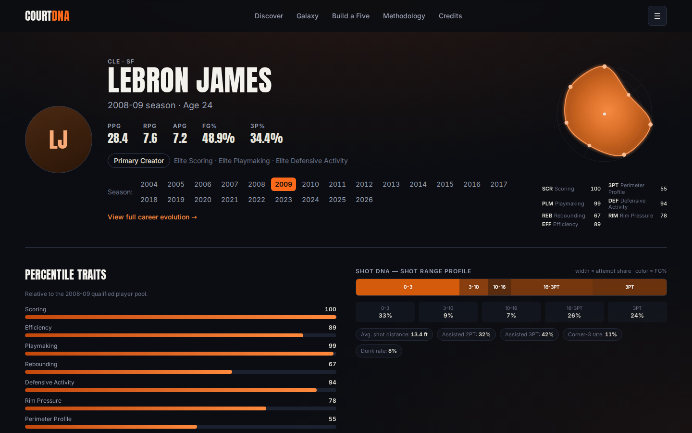

# COURT DNA — Basketball Player Style Explorer



> Independent basketball analytics project. Not affiliated with or endorsed
> by the NBA or any NBA team.

**Live app: [court-dna-basketball-analytics.vercel.app](https://court-dna-basketball-analytics.vercel.app/)**

COURT DNA is an interactive NBA player comparison tool covering the
advanced-stat era, 1996-97 to present, with one consistent 12-feature model.
Search players, compare playing styles, find
similar players, explore career changes, and build lineups.

## What it does

- Compare two NBA players side by side.
- Find players with similar playing styles.
- Explore how a player's game changed across their career.
- See shooting patterns and seven parts of a player's style.
- Explore players on an interactive map.
- Build a five-player lineup and see its combined style.

## How comparisons work

Every player-season is scored on how they score, shoot, pass, rebound, and
defend, using 12 statistical features. Two players' scores are compared to
produce a 0–100 Style Match — a similarity score, not a probability. Full
formula and methodology: [`docs/methodology.md`](docs/methodology.md).

## Data

1996-97 through 2025-26 (30 seasons) · 14,569 canonical player-seasons ·
2,093 players with profile pages · 10,121 comparison-eligible player-seasons.
1996-97 is the start of the historical advanced-stat coverage used by the
12-feature model; this is not all-time NBA history. Source:
Kaggle NBA Stats dataset (CC0). Full detail and reproduction steps:
[`docs/data.md`](docs/data.md).

## Tech

Next.js · React · TypeScript · D3 · Python · Pandas · NumPy · scikit-learn

## Run locally

From the delivered ZIPs (see [`docs/deployment.md`](docs/deployment.md) for the exact extraction steps and the deployment checklist):

```bash
cd court-dna-basketball-analytics     # must contain public/data/shots/manifest.json
npm ci                                # Node 20+ (built and tested on Node 22)
npm run build && npm run start        # production preview at http://localhost:3000
# or: npm run dev
```

or from a clone: `git clone https://github.com/harjotsandhu24/court-dna-basketball-analytics.git`, then the same commands (the shot files must be present, see below).

```bash
npm test
npm run lint
npm run build
```

## QA

Current run: 119 Python tests, 190 TypeScript tests and 111 Chromium browser checks pass, along with lint, typecheck and the production build. Full results and what could not be tested: [`docs/qa.md`](docs/qa.md).

## Known limitations

- Box-score data cannot capture every part of basketball, especially
  off-ball impact and full defensive quality.
- The Player Map is a 2D view of a larger statistical model and is not
  used for the actual similarity ranking.
- Only five player photos are included in this build; other players use
  the fallback graphic.

Full list: [`docs/limitations.md`](docs/limitations.md).

## Documentation

- [Methodology](docs/methodology.md)
- [Data & reproduction](docs/data.md)
- [QA](docs/qa.md)
- [Deployment guide](docs/deployment.md)
- [Limitations](docs/limitations.md)
- [Photo attribution](docs/photo-attribution.md)


## Shooting Profile and supplementary data
The player and Compare pages show a clickable half-court. The court is a uniform dark slate (#111820) with subdued dashed distance guides (3, 10, 16 ft) and solid official markings. Hover a zone (mouse) or focus it (keyboard) for a temporary tooltip with its distance, makes / attempts and shooting % (zones: 0–3, 3–10, 10–16 ft, 16 ft–3PT, three-pointers under 30 ft, and **deep threes**, 30+ ft from the basket, heaves included, with a quiet dashed 30-ft guide); click (or tap on touch) to keep its details below the court. Only the zone's outer boundary is highlighted (hover #93C5FD, selected #60A5FA, keyboard focus dashed); the long-two and three-point bands both highlight the three-point line and deep threes highlight the 30-ft arc. The whole band area is the hover/click target and no fills change. **Show shots** (off by default) draws one dot per recorded attempt at its real location (made = filled circle, missed = ×) with All / Made / Missed controls that filter markers only. Real locations exist for **every regular season 1996-97 to 2025-26** (30 seasons) from `shotdetail.parquet`; playoffs are inventoried, not shown. A season without location data would show "Shot locations aren’t available for this season." with the five distance zones (three-pointers combined, no deep-three split) and labelled estimated counts. See `docs/data.md` ("Real shot locations"), `docs/shot_location_validation.md` (per-season coverage and reconciliation), `docs/limitations.md`.

```bash
pip install -r requirements.txt                                        # includes pyarrow for the Parquet source
python3 analysis/shot_import.py --parquet /path/to/shotdetail.parquet  # inspect, validate, crosswalk, stage, publish (resumable, idempotent)
python3 analysis/step6_export_frontend_data.py
python3 analysis/shot_band_validation.py                               # fails on unreviewed distribution exceptions
npm run build && npx next start -p 3100 &                              # then:
python3 docs/qa/shot_ui_qa.py                                          # Chromium UI checks (writes docs/screenshots/phase5/)
```

Source: `cdechoch/nba-data-archive` on Hugging Face (mirror of shufinskiy/nba_data; stats.nba.com shot-chart detail). Redistribution rights beyond the mirror's Apache-2.0 statement are unresolved (see `docs/data.md`).

```
python3 analysis/step2_build_canonical.py && python3 analysis/step3_features_traits.py && python3 analysis/step4_archetypes.py \
  && python3 analysis/step5_galaxy_pca.py && python3 analysis/step6_export_frontend_data.py
python3 analysis/shot_band_validation.py        # exit status 1 on any unexpected problem
```

**Supplementary NBA data is not in the app.** stats.nba.com (nba_api endpoints) and PBP Stats could not be reached from the build environment (its proxy refused the connection: `Tunnel connection failed: 403 Forbidden`), so no coordinates, hustle, play-type, defensive or on/off data were downloaded, and similarity scoring is unchanged (`similarity_pool.json` is byte-identical to before). A hardened, resumable downloader plus normalizers exist in `analysis/supplementary/` and are **mock-tested only**; `docs/data.md` has the exact Windows PowerShell first-probe commands, expected outputs and success criteria. Attribution: Basketball-Reference statistics via Kaggle; nba_api (MIT code; NBA data terms apply separately).
